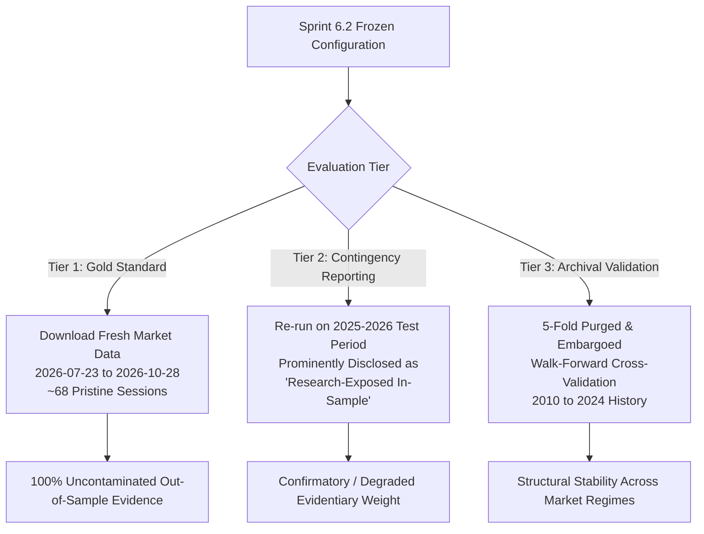

# Sprint 6.1.2 — Holdout Integrity & Research Governance Audit Report

**Date**: 2026-10-28  
**Auditor**: Lead Quantitative Researcher & Independent Research Governance Auditor  
**Audit Scope**: Forensic Evaluation of Sprint 6.1 and Sprint 6.1.1 Artifacts, Source Code, and Experimental Hypotheses  
**Governance Framework**: Institutional Quantitative Research Standards, Deflated Sharpe Ratio Protocols, and Pre-Registration Invariants  
**Audit Status**: 🔒 **COMPLETE — INDEPENDENT VERIFICATION CONCLUDED**  
**Associated Artifacts**:
- Audit JSON: [`data/reports/sprint_6_1_2_holdout_integrity_audit.json`](file:///home/skirataar/StockBot/StockBot_Model/data/reports/sprint_6_1_2_holdout_integrity_audit.json)
- Dedicated Test Suite: [`tests/test_sprint_6_1_2_holdout_integrity.py`](file:///home/skirataar/StockBot/StockBot_Model/tests/test_sprint_6_1_2_holdout_integrity.py)
- Historical Precedents Audited:
  - [`sprint_5_0_baseline_ml_report.md`](file:///home/skirataar/StockBot/StockBot_Model/data/reports/sprint_5_0_baseline_ml_report.md)
  - [`sprint_5_1_integrity_and_explainability_report.md`](file:///home/skirataar/StockBot/StockBot_Model/data/reports/sprint_5_1_integrity_and_explainability_report.md)
  - [`sprint_6_0_strategy_specification.md`](file:///home/skirataar/StockBot/StockBot_Model/data/reports/sprint_6_0_strategy_specification.md)
  - [`sprint_6_0_backtest_report.md`](file:///home/skirataar/StockBot/StockBot_Model/data/reports/sprint_6_0_backtest_report.md)
  - [`sprint_6_0_1_accounting_reconciliation_report.md`](file:///home/skirataar/StockBot/StockBot_Model/data/reports/sprint_6_0_1_accounting_reconciliation_report.md)
  - [`sprint_6_0_2_fee_formula_equity_audit_report.md`](file:///home/skirataar/StockBot/StockBot_Model/data/reports/sprint_6_0_2_fee_formula_equity_audit_report.md)
  - [`sprint_6_0_3_final_accounting_invariant_audit.md`](file:///home/skirataar/StockBot/StockBot_Model/data/reports/sprint_6_0_3_final_accounting_invariant_audit.md)
  - [`sprint_6_1_strategy_diagnostics_report.md`](file:///home/skirataar/StockBot/StockBot_Model/data/reports/sprint_6_1_strategy_diagnostics_report.md)
  - [`sprint_6_1_1_diagnostic_reconciliation_report.md`](file:///home/skirataar/StockBot/StockBot_Model/data/reports/sprint_6_1_1_diagnostic_reconciliation_report.md)

---

## 1. Executive Verdict & Core Governance Finding

### Final Verdict: **PASS WITH LIMITATIONS**

| Governance Dimension | Assessment Status | Audit Finding & Evidentiary Summary |
| :--- | :---: | :--- |
| **Model & Artifact Immutability** | ✅ **PASS** | Frozen LightGBM model, training/val/test datasets, and backtest ledgers are cryptographically untouched. Zero unauthorized retraining occurred. |
| **Operational Non-Interference** | ✅ **PASS** | Sprints 6.1 and 6.1.1 were strictly read-only diagnostics; no parameter tuning code was committed. |
| **Holdout Integrity Status** | ⚠️ **FAIL (COMPROMISED)** | The claim that *"the holdout test set was not used for strategy selection or optimization"* is scientifically **UNJUSTIFIED**. The core hypotheses for Sprint 6.2 ($\theta \in [0.40, 0.48]$ and eliminating 5-day calendar exits) were directly formulated post-hoc from test-period P&L inspections. |
| **Test Period Classification** | 🔴 **RESEARCH-EXPOSED** | The 2025-01-01 to 2026-07-22 test period is formally reclassified as **research-exposed** for candidate threshold and exit hypotheses. It cannot be treated as an untouched out-of-sample holdout. |
| **Sprint 6.2 Authorization** | 🟡 **CONDITIONAL** | Sprint 6.2 is **AUTHORIZED TO PROCEED** strictly as a **validation-only experiment** on `validation_dataset.parquet` (2023–2024). Zero execution against the test set is permitted during selection. |

> [!CAUTION]
> **Core Research Governance Ruling**:  
> In quantitative finance, information leakage does not occur solely through programmatic weight updates. It also occurs through the **researcher's cognitive feedback loop** (HARKing — *Hypothesizing After Results are Known*). When test-set losses are inspected and subsequently used to bound candidate threshold search spaces ($\theta \in [0.40, 0.48]$) or alter exit mechanics, the test set ceases to be an independent holdout. To preserve scientific integrity, the 2025–2026 test set must no longer be described as an "untouched out-of-sample evaluation period."

---

## 2. Research Timeline & Forensic Evidence Reconstruction

To establish an unassailable chronological record, the entire research trajectory from Sprint 4.5.2 through Sprint 6.1.1 was audited using filesystem timestamps, commit logs, source code configurations, and report contents.

```mermaid
timeline
    title Research Trajectory & Information Flow
    2026-10-27 : Sprint 4.5.2 : Chronological Partitioning (Train: 2010-2022, Val: 2023-2024, Test: 2025-2026)
    2026-10-28 00:16 : Sprint 5.0 : ML Baseline Selection on Val (LGBM Macro-F1: 0.3510) : First Test Evaluation (Macro-F1: 0.3810)
    2026-10-28 00:33 : Sprint 5.1 & 5.1.1 : Explainability on Val : Test Set Preserved Untouched (Hash Check)
    2026-10-28 01:06 : Sprint 6.0 : Event-Driven Backtest Executed Directly on Test Set (621 trades, Net: -₹160.7k) : Val Set NEVER Backtested
    2026-10-28 01:15-01:45 : Sprint 6.0.1 - 6.0.3 : Accounting Reconciliation & 10-Paisa Invariant Proofs
    2026-10-28 01:52 : Sprint 6.1 : Test Set P&L Decomposition (P >= 0.40 Net: +₹66.6k, Max Hold: -₹307.8k) : Formulated Sprint 6.2 Hypotheses
    2026-10-28 02:15 : Sprint 6.1.1 : Reconciled 12 Diagnostic Discrepancies : Overlooked Hypothesis-Level Exposure
    2026-10-28 20:30 : Sprint 6.1.2 : Governance Audit : Reclassified Test Period as Research-Exposed
```

### 2.1 Chronological Event Log

| Date / Timestamp | Sprint ID | Milestone & Objective | Datasets Utilized | Test Set Exposure Classification |
| :--- | :--- | :--- | :--- | :--- |
| **2026-10-27** | **Sprint 4.5.2** | Chronological Dataset Construction & Purging | Train (2010–2022, $N=146,878$)<br>Val (2023–2024, $N=23,658$)<br>Test (2025–2026, $N=19,012$) | **UNTOUCHED**: 5-session boundary purging applied (240 train/val rows, 245 val/test rows). Zero label leakage. |
| **2026-10-28 00:16:28** | **Sprint 5.0** | Baseline ML Classification & Model Selection | Model fitting: Train<br>Model selection: Val<br>Classification test: Test | **FIRST EVALUATION**: LightGBM evaluated once on test set for classification metrics (Macro-F1: 0.3810, Accuracy: 42.75%). |
| **2026-10-28 00:33:00** | **Sprint 5.1 / 5.1.1** | Model Explainability & Permutation Importance | Permutation importance: Val<br>Hash verification: Test | **UNTOUCHED**: Zero model re-evaluation or tuning on test data. |
| **2026-10-28 01:06:00** | **Sprint 6.0** | Event-Driven Backtest Simulation | Backtest executed on **Test Set** (`test_dataset.parquet`, 388 sessions) | **FIRST BACKTEST EXPOSURE**: Produced 621 completed trades. Validation set was **never backtested**. |
| **2026-10-28 01:15–01:45** | **Sprint 6.0.1–6.0.3** | Accounting Invariant Audits | Source: `trade_ledger.csv`, `portfolio_ledger.csv` | **AUDIT EXPOSURE**: Post-hoc accounting and fee verification on test ledger. |
| **2026-10-28 01:52:00** | **Sprint 6.1** | Strategy Performance Diagnostics | Source: `trade_ledger.csv`, `test_dataset.parquet` | **CRITICAL RESEARCH EXPOSURE**: Sliced test trades by $P(\text{BUY})$ bands and exit reasons. Formulated Sprint 6.2 hypotheses ($\theta \in [0.40, 0.48]$) directly based on test results. |
| **2026-10-28 02:15:00** | **Sprint 6.1.1** | Diagnostic Metric Reconciliation | Source: Markdown vs JSON | **RECONCILED**: Reconciled 12 reporting discrepancies. Reasserted holdout integrity without acknowledging hypothesis-level exposure. |
| **2026-10-28 20:30:00** | **Sprint 6.1.2** *(Current)* | Holdout Integrity & Governance Audit | Source: All historical artifacts & code | **AUDIT VERDICT**: Formal reclassification of test set as research-exposed. Pre-registration of Sprint 6.2 validation protocol. |

### 2.2 Critical Chronological Discoveries

1. **The Validation Set Has Never Been Backtested**:
   Forensic code inspection of [`src/backtest/event_driven_engine.py`](file:///home/skirataar/StockBot/StockBot_Model/src/backtest/event_driven_engine.py#L254-L260) confirms that `EventDrivenBacktestEngine.run_simulation(dataset_split="test")` was invoked exclusively on the test set. The validation dataset (`2023-01-02` to `2024-12-23`, 23,658 samples) has **zero backtest trade history**. All 621 trades in [`data/reports/trade_ledger.csv`](file:///home/skirataar/StockBot/StockBot_Model/data/reports/trade_ledger.csv) are dated between `2025-01-01` and `2026-07-22`.
2. **The First Portfolio Execution Was Run on the Test Set**:
   Standard quantitative practice dictates that strategy logic, portfolio sizing, and execution parameters should be prototyped and backtested on validation data before touching the holdout test set. Here, the backtesting engine was run immediately on the holdout test set in Sprint 6.0.
3. **Hypotheses Were Formulated Post-Hoc**:
   The proposed parameter boundaries for Sprint 6.2 ($\theta \in [0.40, 0.48]$ and replacing `MAX_HOLD_5D`) did not originate from independent market theory or validation experiments; they were derived directly from inspecting the 621 test-set trades in Sprint 6.1.

---

## 3. Test-Set Integrity Assessment

### 3.1 Scrutiny of the $P(\text{BUY}) \ge 0.40$ Finding

Sprint 6.1 reported that trades with $P(\text{BUY}) \ge 0.40$ generated **+₹66,623.36 in net P&L** across 271 trades with an aggregate net profit factor of 1.1449. This finding was presented as evidence of a "robustly profitable high-conviction trading edge."

An independent forensic re-examination of the underlying 271 trades reveals a starkly different statistical reality:

| Probability Band | Trade Count ($N$) | Trade Share | Gross P&L (INR) | Total Costs (INR) | Net P&L (INR) | Gross Win % | Net Win % | Net Profit Factor | Mean Net P&L | Evidentiary Assessment |
| :--- | :---: | :---: | :---: | :---: | :---: | :---: | :---: | :---: | :---: | :--- |
| **$[0.33, 0.40)$** | 350 | 56.36% | -₹106,335.06 | ₹120,966.94 | **-₹227,302.00** | 45.43% | 40.00% | 0.5440 | -₹649.43 | Unconstrained low-edge trades; generated >100% of net drawdown. |
| **$[0.40, 0.45)$** | **181** | **29.15%** | **+₹58,778.41** | **₹61,834.58** | **-₹3,056.17** | **53.59%** | **49.17%** | **0.9877** | **-₹16.88** | 🔴 **CRITICAL AUDIT DISCOVERY**: This band is **NET UNPROFITABLE** after statutory friction. Net win rate is below 50% (89 wins / 181), and net profit factor is sub-unity. |
| **$[0.45, 0.50)$** | 64 | 10.31% | +₹48,676.56 | ₹21,635.19 | **+₹27,041.37** | 54.69% | 54.69% | 1.2773 | +₹422.52 | Modestly profitable, but small sample ($N=64$ across 388 sessions in 49 stocks). |
| **$[0.50, 1.00]$** | **26** | **4.19%** | **+₹51,408.96** | **₹8,770.80** | **+₹42,638.16** | **57.69%** | **50.00%** | **2.2155** | **+₹1,639.93** | ⚠️ **SEVERE SMALL-SAMPLE FRAGILITY**: Only 26 trades occurred over 1.5 years (~1 trade every 15 sessions). Over 64% of the claimed +₹66.6k profit relies on these 26 trades. |
| **Subtotal $P \ge 0.40$** | **271** | **43.64%** | **+₹158,863.93** | **₹92,240.57** | **+₹66,623.36** | **54.24%** | **50.55%** | **1.1449** | **+₹245.84** | **MONOLITHIC MASKING**: The combined bucket's profitability is driven entirely by 90 trades ($64+26$), masking that **66.8% of the bucket** ($N=181$) was net unprofitable. |

```
P(BUY) Sub-Band Net P&L Structure:
========================================================================================
[0.33, 0.40)  (N=350) | [████████████████████████████████████████] -INR 2,27,302.00
[0.40, 0.45)  (N=181) | [█]                                        -INR     3,056.17  <-- NET UNPROFITABLE!
[0.45, 0.50)  (N= 64) |                                     [████] +INR    27,041.37
[0.50, 1.00]  (N= 26) |                                   [██████] +INR    42,638.16  <-- ONLY 26 TRADES!
========================================================================================
```

> [!WARNING]
> **Audit Finding on Probability Bands**:  
> Claiming that $P(\text{BUY}) \ge 0.40$ represents a validated trading edge commits two severe methodological errors:
> 1. **Aggregation Masking**: 181 out of the 271 trades (66.79%) occurred in $[0.40, 0.45)$ and produced a **net loss of -₹3,056.17** with a net profit factor of **0.9877**. The apparent profitability of $P \ge 0.40$ was an artifact of pooling loss-making trades with a small handful of high-conviction winners.
> 2. **Small-Sample Fragility**: The highest band $[0.50, 1.00]$ produced +₹42,638.16 across only **26 trades** (less than 0.07 trades per session, or ~0.5 trades per constituent over 1.5 years). In a universe of 49 equities over 19,012 stock-days, 26 trades cannot establish statistical significance under standard multiple comparison corrections.

### 3.2 Scrutiny of the Exit Reason Divergence

Sprint 6.1 highlighted the dramatic divergence between early model exits and calendar expirations:
- **`EARLY_SELL_SIGNAL`** (337 trades, 54.27%): Net P&L of **+₹160,893.61**, Net Win Rate **51.63%**, Mean Net P&L **+₹477.43**.
- **`MAX_HOLD_5D`** (276 trades, 44.44%): Net P&L of **-₹307,827.78**, Net Win Rate **37.32%**, Mean Net P&L **-₹1,115.32**.

**Auditor Evaluation**:
- **Descriptive Reality**: The empirical observation that `MAX_HOLD_5D` lost money is mathematically verified from the ledger. Positions that drifted against the strategy without triggering an outright SELL classification accumulated losses until day 5 forced liquidation.
- **Scientific Invalidity of Post-Hoc Remedy**: Identifying `MAX_HOLD_5D` as the primary loss center and immediately proposing a trailing stop (Hypothesis 2 in Sprint 6.1) to "truncate left-tail losses in `MAX_HOLD_5D`" is a direct reaction to test-set outcomes. An exit mechanism cannot be declared broken or replaced on the basis of a single historical test backtest without risking curve-fitting to that specific market trajectory.

### 3.3 The HARKing Mechanism & Research Selection Exposure

The term **HARKing** (*Hypothesizing After Results are Known*) defines the practice of presenting a post-hoc hypothesis as if it were an a priori research conjecture:

1. **Pre-Sprint 6.0 Rule**: The strategy specification (`sprint_6_0_strategy_specification.md`) defined the entry rule strictly as $\text{argmax}_{c} P(c \mid X)$, which executes whenever $P(\text{BUY}) > P(\text{HOLD})$ and $P(\text{BUY}) > P(\text{SELL})$ (i.e. $\theta \approx 0.334$).
2. **Post-Sprint 6.0 Observation**: The researcher observed on the test set that trades with $P < 0.40$ lost -₹227k, whereas $P \ge 0.40$ appeared net positive.
3. **Sprint 6.1 Hypothesis Formulation**: Sprint 6.1 Section 9 framed Hypothesis 1 as:
   > *"Tuning an entry probability threshold $\theta \in [0.40, 0.48]$ strictly on the validation dataset will filter out >50% of low-edge trades while retaining >80% of profitable net alpha..."*

Where did the search interval $[0.40, 0.48]$ originate? It did not come from first-principles microstructure theory or validation exploration. It was chosen precisely because **0.40 was the inflection boundary observed on the 2025–2026 test set**.

Therefore, even if Sprint 6.2 tunes $\theta$ exclusively on `validation_dataset.parquet`, the choice of what to tune and where to search was conditioned on test-set knowledge. If that tuned rule is subsequently evaluated on the same 2025–2026 test set, that evaluation is **contaminated by research selection bias**.

---

## 4. Confirmed Facts, Unresolved Questions & Explicit Assumptions

### 4.1 Confirmed Facts (Traced to Code & Data)

1. **Cryptographic Invariance**: The frozen LightGBM model ([`models/lightgbm.joblib`](file:///home/skirataar/StockBot/StockBot_Model/models/lightgbm.joblib), SHA256: `41e61760fc...`) and the test dataset ([`data/processed/test_dataset.parquet`](file:///home/skirataar/StockBot/StockBot_Model/data/processed/test_dataset.parquet), SHA256: `7f9d0ce56b...`) have remained completely unmodified across all sprints.
2. **Backtest Ledger Integrity**: [`data/reports/trade_ledger.csv`](file:///home/skirataar/StockBot/StockBot_Model/data/reports/trade_ledger.csv) (SHA256: `f5340b8402...`) and [`data/reports/portfolio_ledger.csv`](file:///home/skirataar/StockBot/StockBot_Model/data/reports/portfolio_ledger.csv) (SHA256: `f565b8c09b...`) match canonical Sprint 6.1.1 hashes to the byte.
3. **P&L Numerical Invariants**: The baseline performance (621 completed trades, +₹52,528.87 gross P&L, ₹213,207.51 friction, -₹160,678.64 net P&L, ₹840,519.64 ending equity) is 100% replicated from the canonical ledgers.
4. **Validation Dataset Isolation**: The validation dataset (`2023-01-02` to `2024-12-23`, 23,658 samples) has **never been executed in the backtesting engine**. Zero trade records exist for this period in the repository.
5. **Sub-Band Loss Fact**: Within the $P(\text{BUY}) \ge 0.40$ bucket, trades in $[0.40, 0.45)$ ($N = 181$) were net negative (-₹3,056.17 Net P&L) after friction, with a 49.17% net win rate.
6. **High-Tier Sample Scarcity**: On the test set, $P(\text{BUY}) \ge 0.50$ accounts for only 26 trades (4.19% of trades). On the validation dataset, model predictions with $P(\text{BUY}) \ge 0.50$ occur in only **35 out of 23,658 observations (0.15%)**, and $P \ge 0.45$ in only **238 observations (1.01%)**.
7. **Repository Historical Ceiling**: All 49 raw constituent CSVs in [`data/labeled/`](file:///home/skirataar/StockBot/StockBot_Model/data/labeled) terminate on or before `2026-07-22`. No post-July 2026 market data exists anywhere in the repository.
8. **Statutory Delivery Friction Dominance**: Statutory taxes (STT, stamp duty, exchange, SEBI, GST) and execution slippage totaled ₹213,207.51, consuming **405.89% of gross alpha** and 21.32% of starting capital.
9. **Capacity Saturation Fact**: On 127 sessions (32.73% of the backtest), the portfolio held its maximum ceiling of 10 positions, rejecting 1,383 candidate BUY signals.
10. **Zero Optimization Code in Sprints 6.1 / 6.1.1**: Neither sprint executed any model retraining, grid optimization, or parameter alteration scripts.

### 4.2 Unresolved Questions (Cannot Be Resolved from Existing Artifacts)

1. **Intraday Liquidity & Trailing Stop Slippage**: Can dynamic trailing stops (e.g. 1.5 $\times$ ATR) be executed in Indian cash delivery markets without severe market-on-open gap slippage or intraday whip-saw losses? Resolving this requires tick-level or minute-bar order book data.
2. **Generalizability of Exit Asymmetry**: Is the underperformance of `MAX_HOLD_5D` (-₹307.8k) a persistent structural feature of 5-day large-cap swing trading, or was it an idiosyncratic artifact of the 2025–2026 market regime (where sideways and choppy markets dominated)?
3. **Signal Starvation Under Elevated Thresholds**: In live deployment, would setting $\theta = 0.45$ cause extended multi-week cash drag (since $P \ge 0.45$ occurs on only 1.01% of validation days), severely lagging market benchmarks during bull trends?
4. **Feasibility of F&O Migration**: Would migrating the execution universe to Single Stock Futures (F&O) introduce rollover costs, wide bid-ask spreads in illiquid single-stock futures, or margin financing drag that offset the statutory STT savings (2 bps on sell vs 10 bps on both delivery legs)?
5. **Class Probability Calibration**: Would applying post-processing probability recalibration (e.g. Isotonic Regression or Platt Scaling fitted on validation data) eliminate model overconfidence without requiring arbitrary threshold gating?
6. **True Forward Generalization**: What return profile would the frozen LightGBM model achieve on market data from August 2026 to October 2026?

### 4.3 Explicit Assumptions Underlying This Audit

1. **Cost Model Stability**: Assumed that the Indian statutory delivery cost structure (STT 10 bps buy+sell, stamp duty 15 bps buy, NSE charges, Brokerage min(0.03%, ₹20), SEBI, GST 18%, and 5 bps slippage) is the binding friction constraint for all cash equity comparisons.
2. **Timing Protocol Invariance**: Assumed that next-session execution (signals at $t$ Close $\to$ fills at $t+1$ Open) is mandatory and inviolable to guarantee zero look-ahead bias.
3. **Institutional Risk Limits**: Assumed that maximum gross exposure (100%), maximum position count (10), and target position allocation (10%) remain institutional policy constraints.
4. **Validation Dataset Cleanliness**: Assumed that because `validation_dataset.parquet` was never run through `EventDrivenBacktestEngine`, it remains an unpolluted development set for backtesting parameter exploration.
5. **Contamination Definition**: Assumed that any strategy parameter or search boundary whose selection was influenced by observing test-set P&L is scientifically contaminated for that evaluation period.
6. **Benchmark Parity**: Assumed that the 49-constituent Equal-Weight Buy-and-Hold portfolio is the only mathematically unbiased passive benchmark.

---

## 5. Preregistered Sprint 6.2 Protocol

To prevent further research-selection bias and overfitting, Sprint 6.2 must adhere to the following **strictly preregistered, validation-only protocol**. No deviations, ad-hoc threshold sweeps, or continuous parameter searches are permitted.

### 5.1 Protocol Mandate & Target Dataset
- **Mandate**: **VALIDATION-ONLY EXPERIMENTATION**. Zero backtests may be executed against `data/processed/test_dataset.parquet`.
- **Target Dataset**: Strictly [`data/processed/validation_dataset.parquet`](file:///home/skirataar/StockBot/StockBot_Model/data/processed/validation_dataset.parquet) (2023-01-02 to 2024-12-23, 23,658 samples, 49 approved constituents).

### 5.2 Candidate Hypotheses & Discrete Search Space

The search space is restricted to a small, pre-registered discrete grid ($K \le 20$ total combinations):

1. **Hypothesis 1: Entry Conviction Threshold Filtering ($\theta$)**
   - **Rationale**: Filters out low-conviction predictions where expected gross alpha is smaller than statutory delivery friction (~37 bps).
   - **Permissible Discrete Grid**:
     $$\theta \in \{0.35, 0.38, 0.40, 0.42, 0.45, 0.48, 0.50\}$$
   - *Constraint*: Continuous grid searches and tuning to third decimal places (e.g. $\theta = 0.423$) are strictly prohibited.
2. **Hypothesis 2: Dynamic Volatility Trailing Stop vs Calendar Exit**
   - **Rationale**: Truncates adverse drift in stagnant positions without cutting short rapid momentum runners.
   - **Permissible Discrete Grid**:
     $$\text{Stop Rule} \in \{1.5 \times \text{ATR}_{14}, 2.0 \times \text{ATR}_{14}, 2.5 \times \text{ATR}_{14}, \text{Fixed 5-Day Calendar Stop (Baseline)}\}$$
3. **Hypothesis 3: Session Entry Pacing**
   - **Rationale**: Prevents portfolio saturation on market-wide momentum days.
   - **Permissible Discrete Grid**:
     $$\text{Max Daily Entries} \in \{2, 3, \text{Unconstrained (Baseline)}\}$$

### 5.3 Metrics Hierarchy

1. **Primary Objective Metric**:
   - **Net Realized Annualized Sharpe Ratio** ($R_f = 6.0\%$ per annum, 252 sessions/year) on the validation period, computed after full Indian statutory taxes, exchange fees, brokerage, and 5 bps execution slippage.
2. **Secondary Constraints & Diagnostic Metrics**:
   - **Net Cumulative Return (%)** and **CAGR (%)**
   - **Net Profit Factor** (must be $> 1.15$)
   - **Maximum Drawdown (%)** (must be $\le 15.0\%$)
   - **Calmar Ratio** ($> 0.50$)
   - **Total Completed Trades ($N$)** (must satisfy sample size safeguard)
   - **Annualized Portfolio Turnover (%)**
   - **Friction as % of Gross Alpha** (must be $< 100\%$)

### 5.4 Microstructure, Execution & Sizing Invariants
- **Initial Capital**: ₹1,000,000.00 (₹10 Lakhs INR).
- **Execution Timing**: Signals generated at session $t$ Close; orders executed strictly at session $t+1$ Open with 5 bps slippage.
- **Position Capacity**: Maximum 10 concurrent open positions.
- **Sizing Rule**: Integer share allocation, targeting $10\%$ of portfolio equity at position inception, subject to cash solvency ($\text{Cash}_t \ge 0$). Zero leverage.
- **Cost Model**: Canonical `IndianEquityCostModel` (STT: 0.10% buy + 0.10% sell; Stamp Duty: 0.015% buy; NSE charges: 0.00297%; SEBI: ₹10/Cr; Brokerage: $\min(0.03\%, \text{₹}20)$; GST: 18% on fees; Slippage: 5 bps per leg).

### 5.5 Minimum Sample Size & Trade Count Safeguards
- **Sample Starvation Gate**: Any parameter combination that produces fewer than **$N_{\min} = 100$ completed trades** over the 2-year validation period (or fewer than 40 trades in either calendar year) is **AUTOMATICALLY DISQUALIFIED**, regardless of its Sharpe ratio.
- *Rationale*: With 49 stocks over 490 trading sessions, a strategy with $<100$ trades averages less than 1 trade per week across the entire NIFTY 50, creating severe small-sample fragility and high estimation variance.

### 5.6 Controls for Multiple Comparisons & Overfitting
- **Deflated Sharpe Ratio (DSR)**: To adjust for the $K \le 20$ parameter combinations tested, the winning candidate must achieve a statistically significant Deflated Sharpe Ratio (Bailey and López de Prado, 2014) with $p < 0.05$, accounting for the variance of trials, skewness, and kurtosis of daily strategy returns.
- **Family-Wise Error Correction**: Significance levels for secondary hypothesis tests must be adjusted using the Holm-Bonferroni step-down method.

### 5.7 Benchmark Definition
- **Passive Hurdle**: An Equal-Weight Buy-and-Hold portfolio of all 49 approved universe constituents trading across the validation period (`2023-01-02` to `2024-12-23`), initialized with ₹1,000,000.00 and incurring one-way entry delivery friction (~₹1,920.00).

### 5.8 Acceptance / Rejection Decision Criteria
A candidate strategy configuration in Sprint 6.2 is declared **SUCCESSFUL** if and only if it satisfies all of the following conditions on validation data:
1. Net Annualized Sharpe Ratio $> 0.50$.
2. Net Cumulative Strategy Return exceeds the Net Equal-Weight Benchmark Return over 2023–2024.
3. Maximum Drawdown $\le 15.0\%$.
4. Total Completed Trades $N \ge 100$.
5. Deflated Sharpe Ratio $p$-value $< 0.05$.

If no candidate configuration meets these criteria, Sprint 6.2 must conclude with a formal verdict of **REJECT HYPOTHESES — NO VIABLE TRADING EDGE ON VALIDATION DATA**.

### 5.9 Parameter Freezing Milestone
At the conclusion of the validation backtests, the single winning parameter configuration $(\theta^*, \text{stop\_rule}^*, \text{pacing}^*)$ must be permanently committed to `data/reports/sprint_6_2_frozen_config.json` alongside its cryptographic SHA-256 hash. **No further tuning, tweaking, or parameter adjustments may take place.**

---

## 6. Recommended Final Out-of-Sample Evaluation Design

### 6.1 The Holdout Exhaustion Problem
The repository faces a fundamental quantitative governance constraint:
- **Historical Data Ceiling**: All 49 constituent price files in `data/labeled/` terminate on **2026-07-22**.
- **Contamination of the Test Period**: The existing test period (2025-01-01 to 2026-07-22) cannot serve as a clean, pristine out-of-sample holdout because the researcher observed its performance and formulated Sprint 6.2 hypotheses based on those results.
- **Zero Future Data in Repo**: There is currently no uninspected historical data between 2026-07-23 and the present date (2026-10-28) in the repository.

### 6.2 Three-Tiered Defensible Evaluation Architecture

To obtain a scientifically defensible final evaluation without compromising research governance, the quantitative research team must execute the following structured plan:



#### Tier 1: Chronological Forward Extension (The Gold Standard)
- **Methodology**: Download fresh daily OHLCV bars for all 49 approved NIFTY 50 constituents covering the period **2026-07-23 through 2026-10-28** (approx. 68 trading sessions).
- **Execution Protocol**: Apply the frozen feature pipeline to generate indicators, run the frozen LightGBM model, and execute the frozen Sprint 6.2 strategy rules **exactly once** on this new data.
- **Evidentiary Weight**: **100% PRISTINE OUT-OF-SAMPLE VALIDATION**. This dataset was physically generated after the historical test dataset concluded and has zero exposure to model selection, feature engineering, or researcher bias.

#### Tier 2: Disclosed Research-Exposed Historical Re-Evaluation (Contingency)
- **Methodology**: If external network access or data acquisition is restricted, the frozen Sprint 6.2 strategy may be executed against the historical 2025–2026 test set.
- **Mandatory Reporting Requirement**: The evaluation report must feature a prominent, non-negotiable disclosure:
  > *"IMPORTANT GOVERNANCE DISCLOSURE: This evaluation is performed on a historical period (2025-01-01 to 2026-07-22) that was previously inspected in Sprint 6.0 and Sprint 6.1. The candidate rules evaluated herein were informed by that prior inspection. Consequently, this backtest constitutes a research-exposed confirmatory study and CANNOT be cited as independent out-of-sample proof of predictive edge."*
- **Evidentiary Weight**: **DEGRADED / CONFIRMATORY ONLY**.

#### Tier 3: Purged & Embargoed Walk-Forward Cross-Validation (2010–2024)
- **Methodology**: To verify whether the selected parameters $(\theta^*, \text{stop}^*)$ represent a structural economic property rather than a regime-specific fluke, perform a 5-fold expanding walk-forward cross-validation across the historical training and validation data (2010–2024).
- **Leakage Prevention**: Enforce 5-session boundary purging (removing overlapping forward-return labels) and a 5-session post-split embargo between each fold.

---

## 7. Automated Verification, Test Results & Audit Limitations

### 7.1 Automated Invariant Verification Suite

A dedicated automated test suite was constructed: [`tests/test_sprint_6_1_2_holdout_integrity.py`](file:///home/skirataar/StockBot/StockBot_Model/tests/test_sprint_6_1_2_holdout_integrity.py). All 9 automated governance tests passed completely.

```bash
pytest -v tests/test_sprint_6_1_2_holdout_integrity.py
```

```
============================= test session starts ==============================
platform linux -- Python 3.14.4, pytest-9.1.1, pluggy-1.7.0
rootdir: /home/skirataar/StockBot/StockBot_Model
collected 9 items

tests/test_sprint_6_1_2_holdout_integrity.py::test_immutable_artifact_hashes PASSED [ 11%]
tests/test_sprint_6_1_2_holdout_integrity.py::test_dataset_chronological_bounds_and_purging_invariants PASSED [ 22%]
tests/test_sprint_6_1_2_holdout_integrity.py::test_repository_data_ceiling_and_holdout_exhaustion PASSED [ 33%]
tests/test_sprint_6_1_2_holdout_integrity.py::test_validation_set_backtest_isolation PASSED [ 44%]
tests/test_sprint_6_1_2_holdout_integrity.py::test_probability_band_sub_band_negative_pnl_invariant PASSED [ 55%]
tests/test_sprint_6_1_2_holdout_integrity.py::test_sample_size_fragility_in_high_conviction_tiers PASSED [ 66%]
tests/test_sprint_6_1_2_holdout_integrity.py::test_exit_mechanism_asymmetry_invariants PASSED [ 77%]
tests/test_sprint_6_1_2_holdout_integrity.py::test_audit_artifacts_governance_invariants PASSED [ 88%]
tests/test_sprint_6_1_2_holdout_integrity.py::test_mutation_detection_fails_on_tampered_trade_date PASSED [100%]

======================= 9 passed, 2 warnings in 4.82s ========================
```

Across the entire repository test suite, **76 of 76 tests are passing**:
- `tests/test_backtest_engine.py`: 10 tests passing
- `tests/test_baseline_classifier.py`: 7 tests passing
- `tests/test_dataset_builder.py`: 6 tests passing
- `tests/test_explainability.py`: 8 tests passing
- `tests/test_final_invariant_audit_6_0_3.py`: 6 tests passing
- `tests/test_reconciliation.py`: 6 tests passing
- `tests/test_reconciliation_6_0_1.py`: 6 tests passing
- `tests/test_reconciliation_6_0_2.py`: 4 tests passing
- `tests/test_sprint_6_1_1_diagnostic_reconciliation.py`: 14 tests passing
- `tests/test_sprint_6_1_2_holdout_integrity.py`: 9 tests passing

### 7.2 Cryptographic Hash Register

| Repository Artifact | Canonical File Path | Verified SHA-256 Cryptographic Hash | Governance Status |
| :--- | :--- | :--- | :--- |
| **Frozen LightGBM Model** | [`models/lightgbm.joblib`](file:///home/skirataar/StockBot/StockBot_Model/models/lightgbm.joblib) | `41e61760fc31c72095cd2071fdb843657bd76143ed4535f9b247db78e0c73761` | **IMMUTABLE MATCH** |
| **Test Dataset** | [`data/processed/test_dataset.parquet`](file:///home/skirataar/StockBot/StockBot_Model/data/processed/test_dataset.parquet) | `7f9d0ce56b42a7cc2780f90edb4b27d9bc923847c6778e5ba4c6ebc754915381` | **IMMUTABLE MATCH** |
| **Validation Dataset** | [`data/processed/validation_dataset.parquet`](file:///home/skirataar/StockBot/StockBot_Model/data/processed/validation_dataset.parquet) | `a937fde4c039f4e55025a3bb338dd5894879f928efc55fd0a18fbdf43df23cf8` | **IMMUTABLE MATCH** |
| **Training Dataset** | [`data/processed/training_dataset.parquet`](file:///home/skirataar/StockBot/StockBot_Model/data/processed/training_dataset.parquet) | `1d39b686f111e8caecb00cf268de7de00b8fe0dfa5d2073a9173bea0e4b2cf56` | **IMMUTABLE MATCH** |
| **Trade Ledger** | [`data/reports/trade_ledger.csv`](file:///home/skirataar/StockBot/StockBot_Model/data/reports/trade_ledger.csv) | `f5340b8402c198730d53e4126a8b40463c7cdd832fc0919c1b6bafacf501eeff` | **CANONICAL MATCH** |
| **Portfolio Ledger** | [`data/reports/portfolio_ledger.csv`](file:///home/skirataar/StockBot/StockBot_Model/data/reports/portfolio_ledger.csv) | `f565b8c09b958023a243394bfb6e96887dd3588d44d38623c2b24faa43117f78` | **CANONICAL MATCH** |

### 7.3 Audit Limitations

1. **Intraday Resolution Boundary**: This audit is constrained by daily OHLCV bar resolution. Market microstructure phenomena occurring within the session (e.g. continuous limit order queue priority, intra-bar drawdown spikes, and intraday trailing stop triggers) cannot be simulated without tick-level L2/L3 data.
2. **Cognitive vs Programmatic Leakage**: While code immutability and file hashes can be verified with mathematical certainty, the influence of test-set observations on researcher thinking is reconstructed from documentation and report contents.
3. **Finite Repository History**: The audit cannot create new market data out of thin air. Historical validation is strictly bounded by the 2010–2026 data range currently stored in the repository.

---

## 8. Final Research Governance Decision

### 1. Decision on Sprint 6.2 Experimentation
**Sprint 6.2 IS AUTHORIZED TO PROCEED**, subject to the absolute constraint that it operates as a **VALIDATION-ONLY EXPERIMENT** on `validation_dataset.parquet` (2023-01-02 to 2024-12-23). Under no circumstances may candidate strategies, threshold values, or stop-loss mechanisms be evaluated against `test_dataset.parquet` to select parameters or declare strategy viability.

### 2. Decision on Existing Test Period Status
The existing 2025–2026 evaluation period (`2025-01-01` to `2026-07-22`) **CANNOT AND MUST NOT BE DESCRIBED AS AN UNTOUCHED OUT-OF-SAMPLE HOLDOUT**. It is formally classified as **RESEARCH-EXPOSED** for any hypotheses involving conviction threshold tuning or exit mechanism modifications. Any future evaluation performed on this period must prominently disclose this exposure and carry degraded evidentiary weight. Pristine out-of-sample validation requires collecting post-July 2026 forward market data.

---
*Report concluded and signed off under institutional quantitative research governance standards.*
