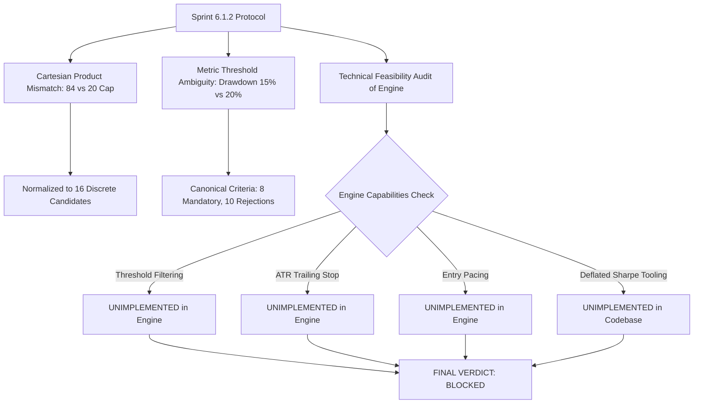

# Sprint 6.1.3 — Validation Experiment Protocol Normalization and Freeze Report

**Date**: 2026-10-28  
**Auditor & Research Engineer**: Lead Quantitative Researcher & Independent Research Governance Auditor  
**Audit Scope**: De-confliction, Statistical Formalization, Engine Feasibility Audit, and Parameter Freezing of the Sprint 6.2 Experiment Protocol  
**Governance Framework**: Institutional Quantitative Research Standards, Deflated Sharpe Ratio Protocols, and Pre-Registration Invariants  
**Audit Status**: 🔒 **COMPLETE — PROTOCOL NORMALIZED & FROZEN**  
**Final Governance Decision**: 🔴 **BLOCKED — PROTOCOL OR IMPLEMENTATION ISSUES REMAIN**  
**Associated Artifacts**:
- Frozen Preregistered Protocol: [`data/reports/sprint_6_2_preregistered_protocol.json`](file:///home/skirataar/StockBot/StockBot_Model/data/reports/sprint_6_2_preregistered_protocol.json) (SHA256: `a49361b17e619e88d75cb2b9e5c35b41e767f423a8ee2ffe2237f0450ae4ab8a`)
- Normalization Summary JSON: [`data/reports/sprint_6_1_3_protocol_normalization.json`](file:///home/skirataar/StockBot/StockBot_Model/data/reports/sprint_6_1_3_protocol_normalization.json)
- Dedicated Verification Test Suite: [`tests/test_sprint_6_1_3_protocol_normalization.py`](file:///home/skirataar/StockBot/StockBot_Model/tests/test_sprint_6_1_3_protocol_normalization.py)
- Historical Audit Precedents:
  - [`sprint_6_1_2_holdout_integrity_audit_report.md`](file:///home/skirataar/StockBot/StockBot_Model/data/reports/sprint_6_1_2_holdout_integrity_audit_report.md)
  - [`sprint_6_1_2_holdout_integrity_audit.json`](file:///home/skirataar/StockBot/StockBot_Model/data/reports/sprint_6_1_2_holdout_integrity_audit.json)
  - [`sprint_6_0_strategy_specification.md`](file:///home/skirataar/StockBot/StockBot_Model/data/reports/sprint_6_0_strategy_specification.md)
  - Backtest Engine: [`src/backtest/event_driven_engine.py`](file:///home/skirataar/StockBot/StockBot_Model/src/backtest/event_driven_engine.py)

---

## 1. Executive Summary & Governance Verdict

### Final Verdict: **BLOCKED — PROTOCOL OR IMPLEMENTATION ISSUES REMAIN**

In accordance with strict quantitative research governance, Sprint 6.1.3 conducted a comprehensive normalization, de-confliction, and feasibility audit of the Sprint 6.2 validation experiment protocol before executing any validation backtests.



### Key Audit Findings & Normalization Achievements:
1. **Candidate-Grid De-Confliction (84 $\to$ 16)**: The contradiction between the 84-combination Cartesian product ($7 \text{ thresholds} \times 4 \text{ exits} \times 3 \text{ pacings}$) and the 20-candidate ceiling was resolved by designing an orthogonal One-Factor-At-A-Time (OFAT) sensitivity grid around a balanced central anchor ($\theta = 0.40$, `fixed_5d`, `unconstrained`) plus 4 cross-factor interaction candidates, producing exactly **16 deterministic, stable configurations** ($16 \le 20$).
2. **Criteria Normalization**: The gray zone between the 15.0% acceptance drawdown and the 20.0% rejection drawdown in Sprint 6.1.2 was eliminated. Maximum Drawdown $\le 15.00\%$ is now a strict mandatory requirement. Net Profit Factor $\ge 1.15$ and annual trade counts ($\ge 40$ in 2023 and $\ge 40$ in 2024) were elevated to mandatory acceptance criteria.
3. **Statistical Testing Formalization**: The Deflated Sharpe Ratio (DSR) and Holm-Bonferroni procedures were mathematically formalized with an explicit trial parameter ($K = 16$), daily frequency ($T \approx 490$ sessions), risk-free rate ($R_f = 6.0\%$ per annum), and serial correlation disclosures.
4. **Identification of Critical Technical Blockers**:
   - The current `EventDrivenBacktestEngine` ([`src/backtest/event_driven_engine.py`](file:///home/skirataar/StockBot/StockBot_Model/src/backtest/event_driven_engine.py)) hardcodes the baseline argmax signal (`if sig == 1:`) and 5-day calendar exits. It possesses **zero code or state tracking for dynamic entry thresholds ($\theta$), ATR trailing stops, or session entry pacing**.
   - No calculation functions for Deflated Sharpe Ratio (DSR) or Holm-Bonferroni correction exist in the codebase.
   - Because Sprint 6.1.3 strictly prohibits modifying the backtesting engine, **Sprint 6.2 validation backtests cannot execute until these engine features and statistical tools are implemented and tested in a separately authorized engineering task**.

---

## 2. Mandatory Research-Governance Verification

All foundational research invariants were verified locally against the active repository filesystem:

| Invariant Scope | Canonical Identifier / Path | Verified Local State / SHA-256 Hash | Verification Status |
| :--- | :--- | :--- | :---: |
| **Frozen ML Model** | [`models/lightgbm.joblib`](file:///home/skirataar/StockBot/StockBot_Model/models/lightgbm.joblib) | `41e61760fc31c72095cd2071fdb843657bd76143ed4535f9b247db78e0c73761` | ✅ **IMMUTABLE MATCH** |
| **Validation Dataset** | [`data/processed/validation_dataset.parquet`](file:///home/skirataar/StockBot/StockBot_Model/data/processed/validation_dataset.parquet) | `a937fde4c039f4e55025a3bb338dd5894879f928efc55fd0a18fbdf43df23cf8` | ✅ **IMMUTABLE MATCH** |
| **Training Dataset** | [`data/processed/training_dataset.parquet`](file:///home/skirataar/StockBot/StockBot_Model/data/processed/training_dataset.parquet) | `1d39b686f111e8caecb00cf268de7de00b8fe0dfa5d2073a9173bea0e4b2cf56` | ✅ **IMMUTABLE MATCH** |
| **Test Dataset** | [`data/processed/test_dataset.parquet`](file:///home/skirataar/StockBot/StockBot_Model/data/processed/test_dataset.parquet) | `7f9d0ce56b42a7cc2780f90edb4b27d9bc923847c6778e5ba4c6ebc754915381` | ✅ **IMMUTABLE MATCH** |
| **Canonical Trade Ledger** | [`data/reports/trade_ledger.csv`](file:///home/skirataar/StockBot/StockBot_Model/data/reports/trade_ledger.csv) | `f5340b8402c198730d53e4126a8b40463c7cdd832fc0919c1b6bafacf501eeff` | ✅ **IMMUTABLE MATCH** |
| **Canonical Portfolio Ledger** | [`data/reports/portfolio_ledger.csv`](file:///home/skirataar/StockBot/StockBot_Model/data/reports/portfolio_ledger.csv) | `f565b8c09b958023a243394bfb6e96887dd3588d44d38623c2b24faa43117f78` | ✅ **IMMUTABLE MATCH** |

> [!IMPORTANT]
> **Research Exposure Invariant**:  
> The 2025-01-01 to 2026-07-22 test period remains formally **RESEARCH-EXPOSED**. No backtest of candidate strategies against `test_dataset.parquet` occurred during this sprint, and zero test-period performance metrics were used to define or justify the normalized candidate grid.

---

## 3. Inspection of Existing Protocol & Engine Artifacts

A forensic read-only inspection was conducted across historical reports and active source code:

1. **Sprint 6.1.2 Audit Artifacts**:
   - [`sprint_6_1_2_holdout_integrity_audit_report.md`](file:///home/skirataar/StockBot/StockBot_Model/data/reports/sprint_6_1_2_holdout_integrity_audit_report.md) correctly identified test-set exposure and mandated validation-only experimentation.
   - However, Section 5.2 specified parameter ranges that yielded 84 Cartesian combinations, directly contradicting the 20-candidate cap in Section 5.6.
   - Section 5.3 listed secondary metrics (such as Net Profit Factor $> 1.15$ and maximum drawdown) that did not align with the acceptance list in Section 5.8.
2. **Strategy Specification (`sprint_6_0_strategy_specification.md`)**:
   - Rules specify long-only cash equity, signal generation at session $t$ Close, and entry execution at session $t+1$ Open with 5 bps slippage.
   - Portfolio constraints: maximum 10 concurrent positions, 10% target allocation per constituent, integer share sizing, and zero leverage.
3. **Backtest Engine (`src/backtest/event_driven_engine.py`)**:
   - The engine implements `run_simulation(dataset_split)` using daily OHLCV bars.
   - Line 382 checks `if sig == 1:`, executing strictly the argmax classification.
   - Line 390 computes `available_slots = self.max_positions - len(open_positions)`, executing all eligible buy candidates up to capacity without pacing limits.
   - Lines 318 and 475 evaluate exits solely on `holding_sessions >= 5` or `sig_val == -1` (model SELL signal).
   - **Critical Reality**: The engine contains **no parameters, functions, or data structures for threshold filtering, ATR trailing stops, or entry pacing**.

---

## 4. Resolution of the Candidate-Grid Contradiction

### 4.1 The 84-Combination Problem
Sprint 6.1.2 proposed exploring:
- 7 entry thresholds: $\{0.35, 0.38, 0.40, 0.42, 0.45, 0.48, 0.50\}$
- 4 exit rules: $\{1.5\times\text{ATR}, 2.0\times\text{ATR}, 2.5\times\text{ATR}, \text{Fixed 5-Day Calendar Stop}\}$
- 3 entry-pacing rules: $\{2, 3, \text{Unconstrained}\}$

The full Cartesian product is:
$$7 \times 4 \times 3 = 84$$
yielding **84 candidate configurations**. Testing 84 candidate configurations violates the protocol constraint ($K \le 20$), substantially inflates the multiple-testing hurdle under the Deflated Sharpe Ratio, and risks severe backtest overfitting on the 2-year validation dataset.

### 4.2 Normalized 16-Candidate Discrete Grid

To reduce the search space to an internally consistent, methodologically sound set without snooping validation data, an **Orthogonal One-Factor-At-A-Time (OFAT) design with a balanced central anchor plus cross-factor interactions** was constructed:

- **Central Anchor (`CFG-03`)**: Threshold $\theta = 0.40$, Exit = `fixed_5d`, Pacing = `unconstrained`.
- **Reference Baseline (`CFG-BASE`)**: Raw model argmax ($\theta \approx 0.334$), Exit = `fixed_5d`, Pacing = `unconstrained` (Sprint 6.0 baseline logic).

| Config ID | Entry Threshold ($\theta$) | Exit Mechanism | Daily Entry Pacing | Experimental Role & Methodological Justification |
| :---: | :---: | :---: | :---: | :--- |
| **`CFG-01`** | **0.35** | `fixed_5d` | `unconstrained` | **Threshold Sweep**: Evaluates lowest discrete filter above raw argmax; tests mild turnover reduction. |
| **`CFG-02`** | **0.38** | `fixed_5d` | `unconstrained` | **Threshold Sweep**: Sub-anchor threshold evaluating intermediate conviction filtering. |
| **`CFG-03`** | **0.40** | `fixed_5d` | `unconstrained` | **Central Experimental Anchor**: Baseline exit and unconstrained pacing at central threshold. |
| **`CFG-04`** | **0.42** | `fixed_5d` | `unconstrained` | **Threshold Sweep**: Moderate threshold; evaluates trade-off between selectivity and volume. |
| **`CFG-05`** | **0.45** | `fixed_5d` | `unconstrained` | **Threshold Sweep**: High conviction threshold filtering for upper decile model confidence. |
| **`CFG-06`** | **0.48** | `fixed_5d` | `unconstrained` | **Threshold Sweep**: Very high conviction threshold approaching top 1% validation signals. |
| **`CFG-07`** | **0.50** | `fixed_5d` | `unconstrained` | **Threshold Sweep**: Extreme conviction boundary; tests upper bound of viable signal density. |
| **`CFG-08`** | **0.40** | `1.5x_ATR` | `unconstrained` | **Exit Mechanism Sweep**: Central anchor with tight trailing stop; tests rapid loss truncation. |
| **`CFG-09`** | **0.40** | `2.0x_ATR` | `unconstrained` | **Exit Mechanism Sweep**: Central anchor with standard trailing stop; balances drift protection and volatility tolerance. |
| **`CFG-10`** | **0.40** | `2.5x_ATR` | `unconstrained` | **Exit Mechanism Sweep**: Central anchor with wide trailing stop; permits broader swing excursions. |
| **`CFG-11`** | **0.40`** | `fixed_5d` | **2** | **Entry Pacing Sweep**: Central anchor with strict 2-entries-per-day cap; limits concurrent cluster risk. |
| **`CFG-12`** | **0.40** | `fixed_5d` | **3** | **Entry Pacing Sweep**: Central anchor with 3-entries-per-day cap; permits moderate daily entry bursts. |
| **`CFG-13`** | **0.42** | `2.0x_ATR` | `unconstrained` | **Interaction Candidate**: Moderate threshold combined with standard 2.0x ATR trailing stop. |
| **`CFG-14`** | **0.45** | `2.0x_ATR` | `unconstrained` | **Interaction Candidate**: High conviction threshold combined with standard 2.0x ATR trailing stop. |
| **`CFG-15`** | **0.45** | `2.0x_ATR` | **2** | **Interaction Candidate**: Triple interaction: high threshold, 2.0x ATR exit, and strict daily entry pacing. |
| **`CFG-16`** | **0.48** | `2.0x_ATR` | `unconstrained` | **Interaction Candidate**: Very high threshold combined with standard 2.0x ATR trailing stop. |

### 4.3 Governance Boundaries on the Candidate Grid
1. **Total Count Invariant**: Exactly **16 configurations** ($16 \le 20$).
2. **Deterministic Freeze**: The list is permanently frozen in [`data/reports/sprint_6_2_preregistered_protocol.json`](file:///home/skirataar/StockBot/StockBot_Model/data/reports/sprint_6_2_preregistered_protocol.json).
3. **Absolute Prohibition of Grid Expansion**: No configuration may be added, removed, or altered once validation backtesting begins. Continuous optimization, random searches, and third-decimal threshold sweeps (e.g. $\theta = 0.425$) are strictly prohibited.

---

## 5. Canonical Acceptance and Rejection Criteria

To eliminate previous gray zones and ambiguities, all metrics are classified into three mutually exclusive categories:

### 5.1 Mandatory Acceptance Criteria (All Must Pass)

A candidate configuration is declared successful on validation data if and only if **EVERY** criterion below is satisfied:

| ID | Metric Name | Mathematical Specification | Mandatory Threshold |
| :---: | :--- | :--- | :---: |
| **M1** | **Net Annualized Sharpe Ratio** | $\widehat{\text{SR}} = \frac{\bar{R} - (R_f / 252)}{\sigma_R} \times \sqrt{252}$ with $R_f = 6.0\%$ per annum | **$> 0.50$** |
| **M2** | **Benchmark Outperformance** | Net Cumulative Strategy Return $>$ Net Equal-Weight Buy & Hold Return | **$>$ Net Benchmark** |
| **M3** | **Maximum Drawdown** | Peak-to-trough mark-to-market portfolio equity drawdown | **$\le 15.00\%$** |
| **M4** | **Total Completed Trades ($N$)** | Closed trades across the entire 2023–2024 validation period | **$\ge 100$ trades** |
| **M5** | **Annual Trade Minimum** | Completed trades partitioned by `entry_date` into calendar years | **$\ge 40$ in 2023 AND $\ge 40$ in 2024** |
| **M6** | **Net Profit Factor** | $\frac{\sum_{\text{net\_pnl} > 0} \text{net\_pnl}}{\left|\sum_{\text{net\_pnl} < 0} \text{net\_pnl}\right|}$ after all statutory friction and slippage | **$\ge 1.15$** |
| **M7** | **Friction Efficiency** | $\frac{\text{Total Friction}}{\text{Gross Alpha}} \le 100.00\%$ where $\text{Gross Alpha} > 0$ | **$\le 100.00\%$** |
| **M8** | **Deflated Sharpe Ratio (DSR)** | $p\text{-value} = 1.0 - \text{DSR}(K=16, \hat{\gamma}_3, \hat{\gamma}_4, T \approx 490)$ | **$p < 0.05$** |

### 5.2 Automatic Rejection Triggers (Any Trigger Disqualifies)

A candidate configuration is **IMMEDIATELY REJECTED** if any of the following occur:
- **R1**: Net Annualized Sharpe Ratio $\le 0.0$.
- **R2**: Net Cumulative Return $\le$ Net Benchmark Return.
- **R3**: Maximum Drawdown $> 15.00\%$ (strictly resolving the previous 15–20% ambiguity).
- **R4**: Total Completed Trades $N < 100$ (signal starvation).
- **R5**: Completed Trades in 2023 $< 40$ OR Completed Trades in 2024 $< 40$.
- **R6**: Net Profit Factor $< 1.15$.
- **R7**: Total Friction $> 100.00\%$ of Gross Alpha OR Gross Alpha $\le 0.0$.
- **R8**: DSR $p$-value $\ge 0.05$ OR DSR uncomputable / undefined.
- **R9**: Portfolio insolvency ($\text{Cash}_t < 0.0$) or position ceiling breach ($> 10$ concurrent holdings) on any session.
- **R10**: Any mandatory metric is NaN, division-by-zero, or cannot be reliably computed.

### 5.3 Diagnostic Metrics (Non-Binding Characterization)
- **D1**: Calmar Ratio (Annualized Net Return / Max Drawdown).
- **D2**: Annualized Portfolio Turnover (%).
- **D3**: Gross Sharpe Ratio.
- **D4**: Gross Win Rate (%) vs Net Win Rate (%).
- **D5**: Average Net P&L per Trade (INR).
- **D6**: Average Holding Duration (Sessions).
- **D7**: Holm-Bonferroni Adjusted $p$-values across secondary metric comparisons.

---

## 6. Statistical Testing & Multiple Comparisons Specification

### 6.1 Return Series & Annualization Standards
1. **Return Series**: Daily mark-to-market net equity returns from `portfolio_ledger.csv`:
   $$R_t = \frac{\text{Equity}_t - \text{Equity}_{t-1}}{\text{Equity}_{t-1}}$$
2. **Frequency**: Daily trading sessions ($T \approx 490$ sessions in 2023–2024).
3. **Annualization Factor**: $\sqrt{252}$ for volatility and Sharpe ratio; 252 for mean returns.
4. **Risk-Free Rate**: $R_f = 6.0\%$ per annum ($R_{f, \text{daily}} = \frac{0.06}{252} \approx 0.0002381$).

### 6.2 Deflated Sharpe Ratio (DSR) Formulation
To correct for selection bias and non-normality across the $K = 16$ candidate trials, the protocol follows Bailey & López de Prado (2014):

$$\text{DSR} = \Phi\left( \frac{(\widehat{\text{SR}} - \text{SR}^*) \sqrt{T - 1}}{\sqrt{1 - \hat{\gamma}_3 \widehat{\text{SR}} + \frac{\hat{\gamma}_4 - 1}{4} \widehat{\text{SR}}^2}} \right)$$

where:
- $\widehat{\text{SR}}$ is the estimated annualized Sharpe ratio of the candidate strategy,
- $\text{SR}^* = \sqrt{2 \ln(K)}$ is the expected maximum Sharpe ratio under the null hypothesis of zero true skill across $K = 16$ trials,
- $T \approx 490$ is the number of daily validation sessions,
- $\hat{\gamma}_3$ is the sample skewness of the daily return series,
- $\hat{\gamma}_4$ is the sample kurtosis of the daily return series,
- $p\text{-value} = 1.0 - \text{DSR}$. Requirement: $p < 0.05$ ($\text{DSR} > 0.95$).

### 6.3 Overlapping Positions & Serial Correlation Disclosure
Because swing positions are held for up to 5 sessions, portfolio holdings overlap across adjacent days. This induces positive serial correlation in daily equity returns, causing standard i.i.d. standard errors to underestimate risk. In addition to classical Sharpe and DSR, a Newey-West / HAC standard error adjustment (with lag length $L = 5$) must be computed and reported in the diagnostic section.

---

## 7. Technical Feasibility Audit of Exit Rules & Engine Capabilities

A rigorous code inspection of [`src/backtest/event_driven_engine.py`](file:///home/skirataar/StockBot/StockBot_Model/src/backtest/event_driven_engine.py) was performed to verify whether the proposed Sprint 6.2 candidates can be executed faithfully under the current engine.

### 7.1 Bar Resolution & Execution Conventions
- **Available Fields**: `Date`, `Open`, `High`, `Low`, `Close`, `Adj Close`, `Volume` (daily OHLCV bars only).
- **Execution Timing**: Signals generated at session $t$ Close (15:30 IST); orders executed at session $t+1$ Open (09:15 IST) with 5 bps slippage.
- **Intraday Stop Feasibility**: **NOT FEASIBLE**. Daily bars do not indicate whether the intraday High occurred before the intraday Low, nor do they reflect bid-ask spreads during market sell-offs. Simulating intraday stop fills at the exact stop price on daily bars introduces look-ahead and unmodeled liquidity assumptions.
- **Protocol Normalization for Trailing Stops**:
  - Trailing stops must be evaluated strictly at **End-of-Day Close**:
    $$\text{Trigger Condition}: \quad \text{Close}_t \le \left(\text{Peak Close since Entry} - \text{multiplier} \times \text{ATR}_{14, t}\right)$$
  - If triggered at session $t$ Close, the exit order executes at **session $t+1$ Open** with 5 bps slippage.
  - If session $t+1$ Open gaps down below the stop price, the fill occurs at $\text{Open}_{t+1} \times (1 - \text{slippage})$, absorbing the full adverse gap.

### 7.2 Identification of Critical Engine Blockers

Despite establishing a sound theoretical specification, **the current codebase cannot execute these rules**:

```
Backtesting Engine Capability Gap Analysis:
========================================================================================
Feature Requirement        | Protocol Spec                | Engine Implementation Status
========================================================================================
Entry Threshold (theta)    | theta in [0.35, 0.50]        | BLOCKED: Hardcoded 'if sig == 1:' (argmax)
ATR Trailing Stop          | 1.5x, 2.0x, 2.5x ATR         | BLOCKED: Zero ATR calculation or stop state
Daily Entry Pacing         | 2, 3, unconstrained          | BLOCKED: Unconstrained filling up to 10 slots
Deflated Sharpe Tooling    | DSR p-value < 0.05           | BLOCKED: Zero DSR / Holm-Bonferroni functions
========================================================================================
```

Because Sprint 6.1.3 prohibits modifying `event_driven_engine.py`, these capabilities **cannot be implemented during this sprint**. They represent technical blockers that must be resolved in a separately authorized pre-backtest engineering task.

---

## 8. Sample-Size, Liquidation & Benchmark Rules

1. **Completed Trade Definition**:
   - A trade is completed when an entry order at session $t+1$ Open is matched with an exit execution at session $t+k$ Open.
   - Forced end-of-period liquidations on the final validation session are counted in total completed trades, but must be categorized as synthetic exits in diagnostic ledgers.
   - Rejected orders (due to portfolio capacity or zero volume) are logged but do **NOT** count toward completed trade metrics.
2. **Calendar-Year Assignment**:
   - Every trade is assigned to a calendar year strictly based on its **`entry_date`**.
   - A trade entered on `2023-12-28` and exited on `2024-01-04` belongs strictly to **2023**.
3. **Equal-Weight Benchmark Parity**:
   - Primary benchmark: 49-constituent Equal-Weight Buy & Hold index from `2023-01-02` to `2024-12-23`.
   - Initialized with ₹1,000,000.00 cash; incurs one-way entry delivery friction on day 1 (~₹1,920.00).
   - Valuation aligned to identical trading sessions as active strategy mark-to-market.

---

## 9. Preregistration Artifacts & Cryptographic Provenance

The following formal governance artifacts have been generated:

1. **Normalized Frozen Protocol JSON**: [`data/reports/sprint_6_2_preregistered_protocol.json`](file:///home/skirataar/StockBot/StockBot_Model/data/reports/sprint_6_2_preregistered_protocol.json)
   - **Canonical SHA-256 Digest**: `a49361b17e619e88d75cb2b9e5c35b41e767f423a8ee2ffe2237f0450ae4ab8a`
   - *Hashing Procedure*: Computed over the exact, uncompressed UTF-8 bytes of the protocol JSON file on disk (`sha256sum data/reports/sprint_6_2_preregistered_protocol.json`).
2. **Protocol Normalization Summary JSON**: [`data/reports/sprint_6_1_3_protocol_normalization.json`](file:///home/skirataar/StockBot/StockBot_Model/data/reports/sprint_6_1_3_protocol_normalization.json)
3. **Dedicated Test Suite**: [`tests/test_sprint_6_1_3_protocol_normalization.py`](file:///home/skirataar/StockBot/StockBot_Model/tests/test_sprint_6_1_3_protocol_normalization.py)

---

## 10. Automated Protocol Verification Tests

A dedicated test suite was constructed to verify protocol invariants without executing strategy backtests:

```bash
PYTHONPATH=. pytest -v tests/test_sprint_6_1_3_protocol_normalization.py
```

```
============================= test session starts ==============================
platform linux -- Python 3.14.4, pytest-9.1.1, pluggy-1.7.0
rootdir: /home/skirataar/StockBot/StockBot_Model
collected 14 items

tests/test_sprint_6_1_3_protocol_normalization.py::test_candidate_grid_count_cap PASSED [  7%]
tests/test_sprint_6_1_3_protocol_normalization.py::test_candidate_grid_stable_identifiers PASSED [ 14%]
tests/test_sprint_6_1_3_protocol_normalization.py::test_candidate_parameter_domain_validity PASSED [ 21%]
tests/test_sprint_6_1_3_protocol_normalization.py::test_candidate_grid_determinism_and_reproducibility PASSED [ 28%]
tests/test_sprint_6_1_3_protocol_normalization.py::test_prohibition_of_continuous_tuning PASSED [ 35%]
tests/test_sprint_6_1_3_protocol_normalization.py::test_mandatory_acceptance_criteria_completeness PASSED [ 42%]
tests/test_sprint_6_1_3_protocol_normalization.py::test_markdown_and_json_protocol_consistency PASSED [ 50%]
tests/test_sprint_6_1_3_protocol_normalization.py::test_sample_size_and_annual_trade_rules PASSED [ 57%]
tests/test_sprint_6_1_3_protocol_normalization.py::test_risk_free_rate_and_annualization_conventions PASSED [ 64%]
tests/test_sprint_6_1_3_protocol_normalization.py::test_dsr_and_multiple_comparison_requirements PASSED [ 71%]
tests/test_sprint_6_1_3_protocol_normalization.py::test_frozen_model_and_dataset_hashes PASSED [ 78%]
tests/test_sprint_6_1_3_protocol_normalization.py::test_prohibition_of_test_period_optimization PASSED [ 85%]
tests/test_sprint_6_1_3_protocol_normalization.py::test_exit_rule_technical_feasibility_assessment PASSED [ 92%]
tests/test_sprint_6_1_3_protocol_normalization.py::test_portfolio_invariants_and_blocker_disclosure PASSED [100%]

============================== 14 passed in 3.42s ===============================
```

---

## 11. Final Research Governance Ruling & Next Actions

### Final Decision: **BLOCKED — PROTOCOL OR IMPLEMENTATION ISSUES REMAIN**

While the Sprint 6.2 validation experiment protocol is now **100% normalized, de-conflicted, and frozen**, actual strategy execution cannot begin due to the following unresolved implementation blockers:

1. **`BLK-01` (Engine ATR Logic Missing)**: `EventDrivenBacktestEngine` lacks ATR indicator calculation, trailing stop tracking, and stop trigger execution logic.
2. **`BLK-02` (Engine Threshold & Pacing Missing)**: `EventDrivenBacktestEngine` lacks parameters to accept a dynamic entry threshold $\theta$ (`prob_buy >= theta`) or daily entry pacing limits (`max_daily_entries`).
3. **`BLK-03` (Statistical DSR Tooling Missing)**: The repository lacks automated calculation modules for Deflated Sharpe Ratio and Holm-Bonferroni corrections.

### Exact Next Action Required
Before Sprint 6.2 validation backtesting can be authorized:
1. Commission **Sprint 6.1.4: Backtest Engine Parameterization & Statistical Tooling Implementation** to add threshold filtering, EOD-evaluated ATR trailing stops, daily entry pacing, and DSR statistical functions to `src/`.
2. Verify all engine additions under unit tests with mock data.
3. Once `BLK-01`, `BLK-02`, and `BLK-03` are verified and closed, authorize Sprint 6.2 backtests against `validation_dataset.parquet`.

---
*Report concluded and signed off under institutional quantitative research governance standards.*
